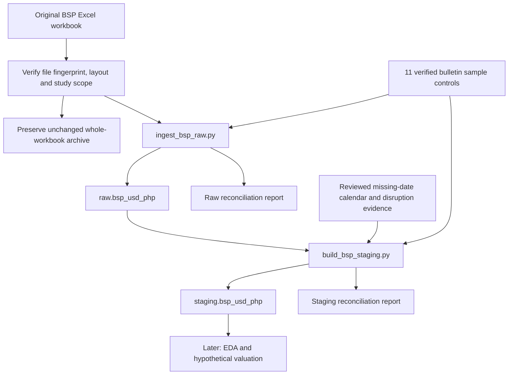

# Data pipeline — BSP USD/PHP prototype

Version 1.0 · Documented 2 November 2026 · Timezone for project dates: Asia/Manila

This document describes the pipeline already implemented and verified in the local project. The raw and staging layers exist. Position valuation, returns, risk metrics and reporting are later work, not completed stages of this pipeline.

## 1. Plain-language explanation

A data pipeline is the repeatable route that data follows from its source to a usable output. In this project, we preserve the original BSP workbook, load its selected USD observations into DuckDB, and create a separate version with numeric rates and explicit missing-value labels. Checks confirm that records have not been lost, duplicated or silently changed.

**Original Excel → verified snapshot → raw records → staging conversion and evidence → checked staging records.**

The original file is the receipt. Raw is the receiving log. Staging is the organized working copy, with numbers ready for calculations and explanations where data is unavailable. Reconciliation is the check that the working copy still agrees with the receipt and receiving log.

The implemented process is **batch ingestion with raw and staging layers**. It is ELT-style: Extract → Load raw → Transform downstream. Basic validation and study-window selection happen before loading; numerical preparation and evidence enrichment happen after raw is stored. This is manually run on a frozen snapshot, not a live feed or scheduled service.

## 2. Diagram of the implemented flow



The bottom node is planned downstream work. Calendar evidence is a separate input; it does not supply replacement exchange rates.

## 3. Inputs and their roles

| Input | Role | Important qualification |
|---|---|---|
| Original `dailycrossrates.xlsx` | Source date and USD cells from worksheet `peso cross daily` | The original local workbook is used, not a Google Sheets conversion or a vendor-rate sheet. |
| `data/reference/bsp_verified_samples.csv` | Eleven previously inspected original BSP bulletin comparisons | Same-provider sample consistency; not independent market accuracy or validation of every historical rate. |
| `data/reference/bsp_missing_calendar_20261102.csv` | Reviewed calendar and disruption context for 817 missing-rate dates | Not a full trading calendar and not proof of each date's exact publication cause. |

The source unit is PHP per US$1. The selected workbook USD field matches the bulletin's USD-row **PHIL. PESO EQUIVALENT** in the 11 inspected samples. It is distinct from the separately labelled BSP Reference Rate and PDS Closing Rate. External vendor observations are not inserted into either implemented BSP table.

## 4. Stage A — source validation and scoped extraction

Script: `scripts/ingest_bsp_raw.py` → `sha256()` and `read_source()`.

1. Compare the workbook's SHA-256 fingerprint with the verified snapshot. A different file is refused.
2. Select `peso cross daily` and verify the date/USD headers in A5:B6.
3. Read columns A and B from the verified data region, rows 9–17,813. Header/footer material is outside that region.
4. Check date cells and preserve their original values/types. Select the inclusive study window **2020-01-01 through 2026-09-30**. Earlier workbook history remains in the archived file but is not loaded into this study table.
5. Check the frozen source controls: unique/complete date coverage, positive finite numeric rates and exact `..` source markers. Unexpected source input fails this frozen-snapshot load rather than being silently repaired.

This loader is deliberately tied to a reviewed snapshot. Its fixed hash, row boundary, cutoff and reconciliation totals are not a general automatic-update policy.

## 5. Stage B — archive, load raw and reconcile

Script: `scripts/ingest_bsp_raw.py` → `ingest()`.

The full workbook is copied unchanged into `data/raw/bsp/` under a filename containing its complete SHA-256. The copy's hash is checked. The project database is `traded_risk.duckdb`.

The loader inserts the scoped records into **`raw.bsp_usd_php`**. The rate column is `usd_php_raw` (VARCHAR), so both numerical values represented as text and the original `..` markers are retained. Original cell type and number format remain available. Original workbook bytes, including formatting outside these stored fields, are preserved in the archived file.

| Raw field group | Purpose |
|---|---|
| `snapshot_sha256`, `source_file`, `snapshot_file`, `source_sheet` | Identify the source version and worksheet. |
| `source_row`, `source_date`, `source_date_raw`, `source_date_cell_type` | Locate the original Excel cells and retain the date-cell evidence. |
| `usd_php_raw`, `usd_php_cell_type`, `usd_php_number_format` | Preserve the original rate/marker and cell metadata. |
| `ingested_at` | Record actual pipeline execution time; not historical BSP public availability. |

Raw primary key: `(snapshot_sha256, source_sheet, source_row)`.

Before committing, the loader compares all saved source payload fields with the extracted records and checks all 11 sample values and source rows. Results are written to `reports/raw_ingestion.json`.

Repeating the same raw load verifies the existing payload, inserts zero extra rows and preserves its original ingestion timestamps. A partial or conflicting previous load is refused; the script does not overwrite or average existing source records.

## 6. Stage C — transform raw into staging

Script: `scripts/build_bsp_staging.py` → `parse_rate()`, `read_evidence()` and `make_record()`.

The staging script reads **raw from DuckDB**. It does not reopen the Excel workbook or collect new market prices. It preserves the source identity, date, Excel row and raw rate, then adds a usable numeric rate and status.

| Input case | `usd_php_rate` | `rate_status` |
|---|---:|---|
| Positive finite value from a numeric source cell | Numeric value | `valid` |
| Exact `..` text marker | NULL | `source_missing` |
| Empty or absent cell | NULL | `blank` |
| Unsupported text, formula, boolean or Excel error | NULL | `invalid_input` |
| Numeric zero, negative, NaN or infinity | NULL | `invalid_numeric` |

Python `None` becomes SQL `NULL`. NULL means unavailable; it is not zero. The current frozen source contains only `valid` and `source_missing` observations. Other conversion cases were checked in disposable tests; unexpected current-snapshot counts cause a failed build requiring review.

The reviewed reference CSV is matched by date and original source row. Duplicate evidence dates, unmatched marker dates and absent required qualifications are refused. This avoids multiplying or dropping source records during enrichment.

**Rate status and calendar context answer different questions:**

- `rate_status`: is a usable numeric rate available?
- `calendar_status` and evidence notes: what is known about the date?
- `event_context` and disruption notes: what emergency context was documented?
- `publication_cause_status`: how much is actually established about bulletin nonpublication?

For missing observations, the saved context is 704 weekends, 106 proclaimed national non-working weekdays and seven other weekdays with investigated disruption context. The seven retain `review_status = investigated_with_qualification` and `publication_cause_status = unconfirmed`. Calendar-policy assumptions and evidence links remain in the notes. Other weekdays have `weekday_not_reviewed`, which means this missing-date register did not assess them; it is not a bad-rate flag.

The evidence file's full hash and `staging_version` are stored for traceability. No market date, historical public-release timestamp, one-day interval eligibility or replacement rate is inferred.

## 7. Stage D — check staging, then save

Script: `scripts/build_bsp_staging.py` → `build()`.

Candidate records must pass scope/count checks, date uniqueness/coverage, missing-evidence matching, expected rate-status counts and the 11 sample controls. Only then does the script rebuild the selected snapshot in **`staging.bsp_usd_php`**.

Staging primary key: `(snapshot_sha256, source_sheet, source_row)`. Dates are also unique within each snapshot. Other snapshots, if present, are retained. An incompatible existing staging schema is refused rather than replaced.

Database writes use a transaction:

- **COMMIT:** save the new staging result when all checks pass.
- **ROLLBACK:** restore the prior state if a check or insertion fails, including after a snapshot's old derived rows have been deleted inside the transaction.

The saved staging payload is compared with the candidate records. Raw is compared before and after to confirm it has not changed. `reports/bsp_staging.json` records the result. A repeated build produces the same derived values without duplicate rows; `staged_at` changes to the actual rebuild time.

## 8. Verified checkpoint

These results were read from the actual project database and saved execution reports on 2 November 2026:

| Control | Raw | Staging |
|---|---:|---:|
| Records | 2,465 | 2,465 |
| Unique source dates | 2,465 | 2,465 |
| Study window | 2020-01-01–2026-09-30 | Same dates |
| Positive numeric source values / usable numeric rates | 1,648 | 1,648 |
| Missing observations | 817 original `..` markers | 817 NULL rates with `source_missing` status |
| Verified sample controls matched | 11/11 | 11/11 |
| Dates outside the study window | 0 | 0 |

Every staged source identity matches a raw record. No missing rate was converted to zero. Raw was independently compared with the pre-staging database backup and remained identical. Saved raw and staging payload readbacks passed.

Additional checks on disposable databases covered changed-source rejection, raw rerun stability, incomplete-load refusal, 12 staging conversion boundaries, staging repeat-build stability and a deliberately triggered late insertion failure to verify transaction rollback. These were adviser-run checks; no independent learner mastery or production reliability is implied.

## 9. Run order and project files

With the existing project virtual environment active:

```bash
python scripts/ingest_bsp_raw.py --source data/raw/dailycrossrates.xlsx
python scripts/build_bsp_staging.py
```

These commands are shown for reproducibility; both steps have already run successfully. The raw command can instead receive the archived workbook path if the Downloads file moves. Script default paths are anchored to the project directory. No scheduler or automatic orchestration currently runs these commands.

| Location | Contents |
|---|---|
| `scripts/` | The two Python scripts. |
| `data/raw/bsp/` | Full unchanged workbook snapshot. |
| `data/reference/` | Eleven-sample controls and reviewed missing-date evidence. |
| `traded_risk.duckdb` | Implemented raw and staging tables. |
| `reports/raw_ingestion.json` | Raw load and reconciliation result. |
| `reports/bsp_staging.json` | Staging counts, source/evidence hashes and verification result. |
| `sql/inspect_bsp_raw.sql`, `sql/inspect_bsp_staging.sql` | Read-only inspection queries. |
| `backups/` | Pre-raw and pre-staging local database backups. |
| `requirements-ingestion.txt` | Recorded DuckDB/openpyxl/pytz versions used by the environment. |

Detailed walkthroughs: [Raw ingestion guide](RAW_INGESTION_GUIDE.md) and [Staging guide](STAGING_GUIDE.md). Column meanings and qualifications: [Data dictionary](DATA_DICTIONARY.md), [Handling rules](DATA_HANDLING_RULES.md), [Publication-calendar review](PUBLICATION_CALENDAR_REVIEW.md) and [Seven-date investigation](SEVEN_DATE_INVESTIGATION.md).

## 10. Limitations and future work

The pipeline verifies faithful capture and explicit transformation, not the economic correctness of every source rate. The 11 original-document comparisons are sampled same-provider consistency checks. Full historical rate-construction continuity, underlying trading-date alignment and public-availability/revision history remain qualified.

The missing-date calendar reference is not a complete publication/trading calendar. Seven disruption contexts do not certify seven bulletin cancellations. The three numeric-rate dates without current archive items remain a separate source/archive evidence question; their rates were not erased or replaced.

Do not label a change between consecutive usable observations as a one-day trading return solely because both endpoints are present. A homogeneous horizon and defensible date/availability assumptions must precede dependent risk calculations.

Future BSP updates require a controlled snapshot comparison and loader review. The current raw loader deliberately rejects a different file hash; changing that hash alone is insufficient because data boundaries, cutoff, controls and possible historical corrections also require review. Existing frozen versions must not be silently overwritten.

**Not implemented:** scheduled/live ingestion, external-rate replacements, analytics/risk tables, hypothetical position valuation, returns, volatility, VaR, stress testing, backtesting or dashboard delivery. These are downstream work. The raw and staging layers are the completed technical checkpoint.

## 11. Authorship and explanation

The user chose to preserve the BSP series, requested raw/staging implementation and asked for a documented, layman walkthrough. The adviser prepared the code, evidence mapping and verification. Technical correctness checks do not establish the learner's independent coding or methodological defense; understanding is developed through the ongoing walkthrough.

An explanation for an interview:

> I used a batch pipeline to preserve a frozen BSP Excel snapshot, load traceable raw observations into DuckDB, and create a separate staging table with numeric rates and explicit quality flags. I reconciled the records between stages, preserved missing data without filling it, and documented timing and source limitations before downstream risk analysis.
