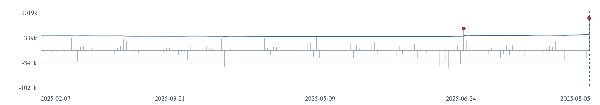
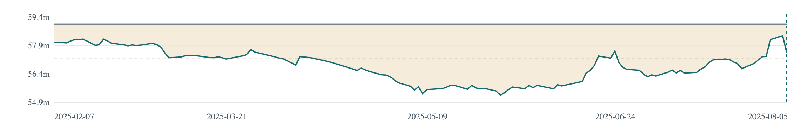

# Historical USD/PHP FX risk

On 5 August 2025 a hypothetical long USD 1 million holding lost ₱878,000 in peso value. The prior historical VaR was ₱425,719.97. Follow that observation through the source checks, model and review dashboard.

[Read the research article](project-report.html) · [Explore the dashboard](reports/guided_historical_report_v1/index.html) · [Replay the results](docs/REPRODUCIBILITY.md)

Local portfolio edition, 12 November 2026. Extract the whole folder and open the article in a browser. The dashboard uses saved results and supports offline review. For reuse and publication conditions, read the [sharing review](docs/DATA_AND_SHARING.md).

## Problem and intended user

A rate chart alone does not tell a hypothetical Market Risk officer how much a USD position changed in PHP, whether a loss exceeded its prior estimate, or what evidence deserves review. This project supports that investigation using a fixed unhedged long USD 1 million and PHP reporting. It does not execute trades, predict FX direction or establish bank limits.

## What was built

1. Preserve BSP source observations and classify missingness; no return filling or replacement-rate substitution.
2. Construct original intervals with source rows, calendar gaps and eligibility evidence.
3. Explore returns, valuation P&L, volatility, tails and drawdown.
4. Estimate rolling 99% historical VaR using 250 prior eligible changes and the `higher` quantile; validate subsequent signed losses using exact arithmetic.
5. Challenge the baseline with 500-change, linear-quantile and seven-review-interval sensitivities; inspect timing and gap-group performance.
6. Apply ±1%, ±3%, ±5% and one historical decline; keep a dated BPI Group disclosure as a separate static illustration.
7. Build a historical review dashboard with date controls, charts, illustrative drawdown episodes, evidence and browser-local review notes.

## Key findings

- Study calendar: 1 Jan 2020–30 Sep 2026. The workbook has 2,465 calendar rows, 1,648 numeric rates and 817 missing markers. There are 1,647 original changes, 1,640 main candidates and 7 review intervals.
- Main VaR evaluation: 20 Jan 2021–30 Sep 2026, **22 exceptions across 1,390 targets (1.5827%)**. Single-calendar-day intervals recorded 12/1,069 and multi-day intervals recorded 10/321. These are mixed-duration published-observation intervals, not certified one-day trading returns.
- Example 4–5 Aug 2025: **PHP 878,000 valuation loss**, prior VaR **PHP 425,719.97**, exceedance **PHP 452,280.03**, for the hypothetical USD 1 million.
- 2%/3%/4% drawdown comparisons produce 20/15/12 new crossings. They reveal review-workload tradeoffs and do not identify an optimal bank limit.
- Latest stress baseline was 62.485 PHP/USD on 30 Sep 2026; a −5% shock gives PHP 3,124,250 loss. The BPI supporting case uses positive PHP 814 million net USD exposure in peso equivalent at 31 Dec 2025, not the hypothetical USD holding or actual BPI VaR.

## Try it locally

Download/extract the **entire folder** and open `project-report.html` or `reports/guided_historical_report_v1/index.html` in a browser. No installation or live feed is needed for the dashboard. GitHub's file viewer displays HTML source; a local browser renders the report. Publishing/hosting is a separate decision.

For numerical replay from the included attributed extracts:

```bash
python3 scripts/replay_saved_study.py
python3 scripts/verify_package.py
```

Python 3.11+ standard library is sufficient for these two scripts. The portable replay checks all 1,390 main VaR estimates and 14 stress P&Ls. It writes only to ignored `.local-runs/`. It is **not** a repeat of the full raw-source audit. See [reproducibility boundaries](docs/REPRODUCIBILITY.md).

Optional offline dashboard interaction tests require Node.js:

```bash
node scripts/check_guided_report_presentation.cjs
```

That test uses synthetic in-memory notes and may regenerate local QA artifacts; it is not an actual-browser pass. Regenerate the package manifest before distributing an altered copy.

## Visual previews

These are chart-only previews generated from saved dashboard data, not screenshots proving browser acceptance.




## Validation and limits

The original study has frozen exact target/training exports and completed source checks for all 44 main-exception endpoints. Dashboard automation checks passed; an independent retest passed 76 isolated assertions, and a bounded native-browser walkthrough was completed. Other browsers, actual denied-storage unload behavior and independent novice comprehension remain unverified.

The stress notebook safeguards passed 18 acceptance tests and six fresh-kernel code cells with no cell errors; all 14 scenario results matched the original exact values. Missing/invalid BPI evidence was tested in isolated fixtures and USD-only results still completed; interrupted exports did not overwrite earlier success.

Source/economic-date mapping, per-observation historical public availability and full-series methodology continuity remain qualified. Thresholds are illustrative. Static BPI shocks omit complete economic hedges, nonlinearities and changing holdings. Original BPI publication date is not established. Successful software tests do not certify financial-model adequacy or operational bank readiness.

## Repository guide

- `project-report.html`: problem, objectives, research questions, framework, methods, findings and limits.
- `reports/guided_historical_report_v1/`: working dashboard v2.2; historical folder name retained for linked evidence.
- `data/processed/`: attributed BSP-derived interval extract, with unchanged source IDs/gaps.
- `reports/`: selected exact results, stress figures and source-audit register.
- `research_source/`: cleaned research-notebook reading copies and original workflow scripts. Outputs/local metadata were removed; full-workspace dependencies are intentionally not bundled.
- `docs/`: source review, reproduction scope, environment, contributions and publication checklist.

[Editorial design guide](docs/EDITORIAL_BRAND.md) · [Change log](docs/EDITORIAL_CHANGELOG.md) · [Research integrity](docs/RESEARCH_INTEGRITY_AUDIT.md) · [References](docs/REFERENCE_AUDIT.md) · [Validation results](docs/EDITORIAL_VALIDATION.md) · [Publication readiness](docs/PUBLICATION_READINESS.md)

## Authorship and assistance

This project documents the guided-report approach, source preservation, threshold comparisons and selected-date chart cutoff. Readers can trace and evaluate each claim through the included evidence. See [project context](docs/CONTRIBUTIONS.md).

## Attribution and licensing

Underlying exchange-rate observations originate from **Bangko Sentral ng Pilipinas (BSP)** publications, freely available through BSP. Processing selected the USD column, preserved source dates/rows, classified gaps and calculated derived intervals and hypothetical risk metrics; this is a modified analytical extract, not an official BSP output or endorsement. BSP attribution/third-party exceptions remain applicable. No BSP/BPI logos, raw workbook, bank PDF, local database or personal review-note exports are included.

BPI is cited only for the separately dated disclosure and simplified derived illustration. A blanket redistribution permission for its PDF was not established, so the PDF is excluded. The repository code and original documentation are available under the [MIT License](LICENSE). Third-party data, source publications and cited materials remain subject to their respective terms. Read [sharing review](docs/DATA_AND_SHARING.md) before publication.
